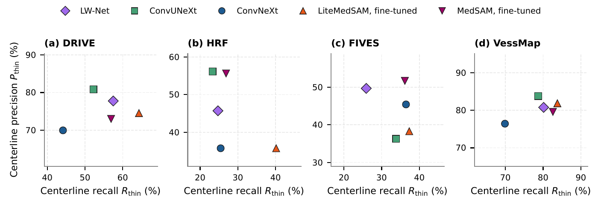
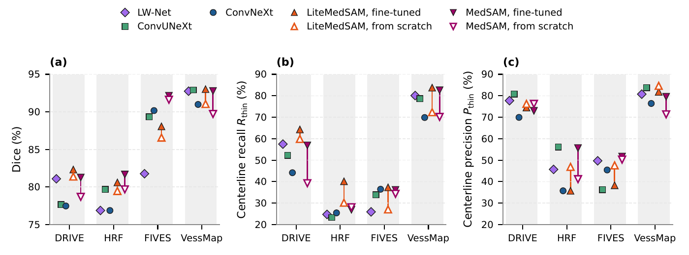

# How well do SAM-based models segment thin retinal vessels?

Thin vessels, one or two pixels wide, are the easiest part of a retinal vessel map to miss. It is often assumed that
vision transformers, which look at an image in patches of many pixels, miss them more than convolutional networks do.
Our paper tests how far that holds: it compares MedSAM and LiteMedSAM, two Segment Anything models for medical
images, with three convolutional networks on four datasets (DRIVE, HRF, FIVES and VessMap), looking at thin vessels
in particular.

This repository has the code to reproduce the paper's experiments, from training the models to every figure and
table.

> **Evaluating SAM-based and Convolutional Architectures in Thin Retinal Vessel Segmentation: Model Capacity,
> Computational Cost and Foundation Pre-training.** Carlos E. Fontaneli and Cesar H. Comin, Federal University of
> São Carlos (UFSCar).

<p align="center"></p>
<p align="center"><em>Centerline recall by vessel radius on the four datasets. The first bin, radius below 1.5 px, is the thin vessels; grey bars count the ground-truth centerline pixels of each bin.</em></p>

## Main findings

**A pre-trained plain ViT does not miss thin vessels.** Fine-tuned from its published weights, MedSAM, whose encoder
splits the image into 16-pixel patches, reached a thin-vessel centerline recall that was not significantly different
from that of the best CNN on all four datasets (−0.6 to +2.5 percentage points), with a lower thin-vessel precision
on DRIVE and VessMap. On HRF and FIVES it also had a significantly higher Dice than the best CNN, with no significant
loss in thin-vessel recall or precision.

**The hybrid LiteMedSAM finds the most thin vessels.** With 9.8 M parameters, a tenth of MedSAM, LiteMedSAM had the
highest mean thin-vessel recall on every dataset, trading some precision for it.

**Pre-training is what makes the difference.** Pre-training raised MedSAM's Dice significantly on every dataset.
Trained from scratch, MedSAM fell significantly below the best CNN in thin-vessel recall on three datasets, and a
compact plain ViT found by architecture search and trained from scratch did not keep the performance either.

**Small CNNs remain strong where cost matters.** LW-Net, with 0.07 M parameters, had a Dice and a thin-vessel recall
not significantly different from those of fine-tuned MedSAM on DRIVE and VessMap, at a small fraction of its cost per
image.

**Evaluate a plain ViT at the scale it was trained on.** DRIVE and VessMap images are smaller than MedSAM's 1024 px
window. Upscaling them to the window, as in training, is what keeps MedSAM's thin-vessel recall in the range of the
CNNs; padding them instead drops it below that range at the same cost.

In short: for pre-trained plain ViTs, our results do not support the common expectation that they miss thin
vessels, although similar thin-vessel performance can be obtained with much smaller models.

<p align="center"></p>
<p align="center"><em>Thin-vessel centerline precision against recall, per dataset: where each model sits between finding thin vessels and drawing false ones.</em></p>

<p align="center"></p>
<p align="center"><em>Agreement between the models on thin vessels: (a–d) the window of each test set with the most thin centerline pixels; (e) the share of thin centerline pixels found by all five models, by some of them, or by none, over all test images.</em></p>

<p align="center"></p>
<p align="center"><em>Effect of pre-training: Dice, thin-vessel recall and thin-vessel precision of MedSAM and LiteMedSAM fine-tuned (filled) and trained from scratch (hollow), next to the three CNNs.</em></p>

## Quickstart

```bash
git clone https://github.com/CarlosFontaneli/thin-vessel-sam-cnn.git && cd thin-vessel-sam-cnn
python -m venv .venv && source .venv/bin/activate
make install          # Python 3.11 or newer
make test             # unit tests, about ten seconds on CPU
make figures          # every figure and table of the paper, from the tables in results/
make paper            # compiles the paper into outputs/paper/main.pdf (needs TeX Live)
```

The figures and tables need neither the datasets nor a GPU. To train the models and evaluate them yourself, see
[`docs/data.md`](docs/data.md) for the datasets and weights and [`docs/reproduction.md`](docs/reproduction.md) for
the commands.

## What is here

- `src/thinvessel/`: the Python package (data, models, training, evaluation)
- `configs/`: one configuration per model and dataset, with the hyperparameters used in the paper
- `scripts/`: the command-line tools, from training to scoring
- `results/`: the tables behind the paper's numbers
- `paper/`: the LaTeX source of the paper and the scripts of its figures and tables
- `docs/`: data, reproduction and hyperparameter details

## Licence

The code is under the MIT licence ([`LICENSE`](LICENSE)); vendored code keeps its own licence
([`THIRD_PARTY_NOTICES.md`](THIRD_PARTY_NOTICES.md)). The text and figures of the paper are not covered by the MIT
licence (see [`paper/README.md`](paper/README.md)).

## Citation

```bibtex
@unpublished{fontaneli2026thinvessel,
  title  = {Evaluating {SAM}-based and Convolutional Architectures in Thin Retinal Vessel Segmentation: Model
            Capacity, Computational Cost and Foundation Pre-training},
  author = {Fontaneli, Carlos E. and Comin, Cesar H.},
  year   = {2026},
  note   = {Manuscript under review}
}
```

See also [`CITATION.cff`](CITATION.cff). Contact: Cesar H. Comin, <comin@ufscar.br>.
