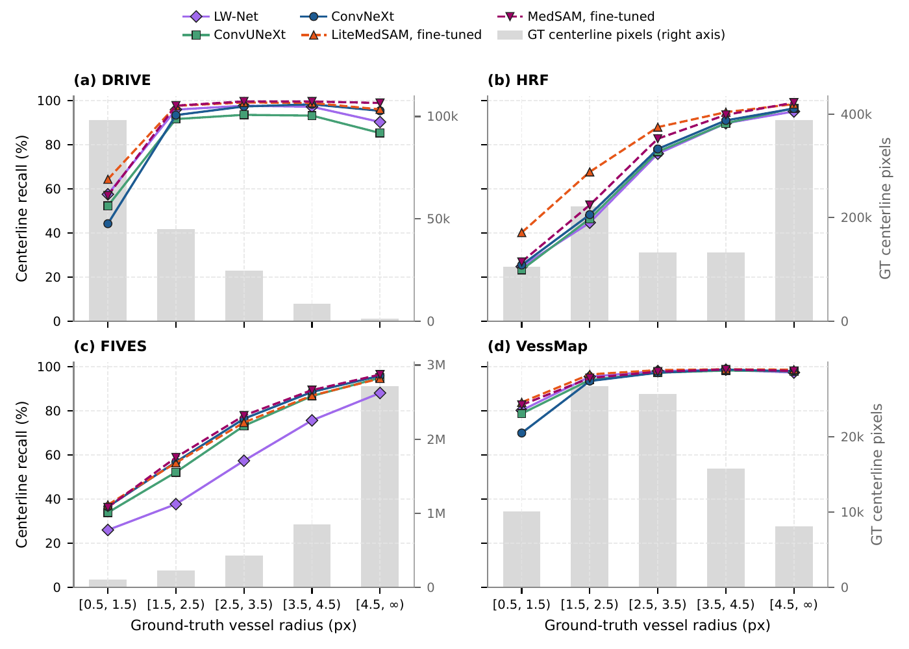
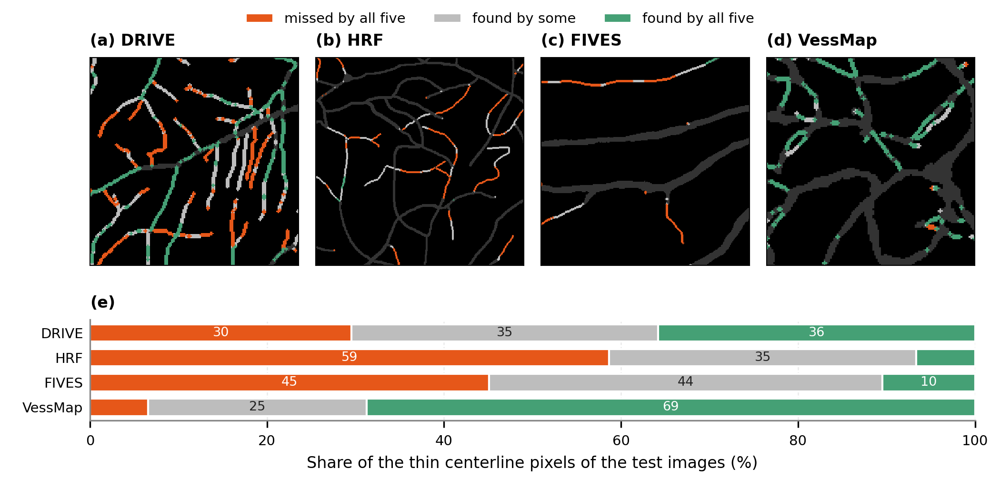

# How well do SAM-based models segment thin retinal vessels?

Thin vessels, one or two pixels wide, are the easiest part of a retinal vessel map to miss. It is often assumed that
vision transformers, which look at an image in patches of many pixels, miss them more than convolutional networks do.
Our paper tests how far that holds: it compares MedSAM and LiteMedSAM, two Segment Anything models for medical
images, with three convolutional networks on four datasets (DRIVE, HRF, FIVES and VessMap), looking at thin vessels
in particular.

This repository has the code to reproduce the paper's experiments, from training the models to every figure and
table.

> **Evaluating SAM-based and Convolutional Architectures in Thin Retinal Vessel Segmentation: Model Capacity,
> Computational Cost and Foundation Pre-training.** Carlos E. Fontaneli and Cesar H. Comin, Federal University of
> São Carlos (UFSCar).

<p align="center"></p>
<p align="center"><em>Centerline recall by vessel radius, for the five models on each dataset. Grey bars: ground-truth centerline pixels in each radius bin.</em></p>

<p align="center"></p>
<p align="center"><em>Thin vessels found by all five models, by some of them, or by none.</em></p>

## Quickstart

```bash
git clone https://github.com/CarlosFontaneli/thin-vessel-sam-cnn.git && cd thin-vessel-sam-cnn
python -m venv .venv && source .venv/bin/activate
make install          # Python 3.11 or newer
make test             # unit tests, about ten seconds on CPU
make figures          # every figure and table of the paper, from the tables in results/
make paper            # compiles the paper into outputs/paper/main.pdf (needs TeX Live)
```

The figures and tables need neither the datasets nor a GPU. To train the models and evaluate them yourself, see
[`docs/data.md`](docs/data.md) for the datasets and weights and [`docs/reproduction.md`](docs/reproduction.md) for
the commands.

## What is here

- `src/thinvessel/`: the Python package (data, models, training, evaluation)
- `configs/`: one configuration per model and dataset, with the hyperparameters used in the paper
- `scripts/`: the command-line tools, from training to scoring
- `results/`: the tables behind the paper's numbers
- `paper/`: the LaTeX source of the paper and the scripts of its figures and tables
- `docs/`: data, reproduction and hyperparameter details

## Licence

The code is under the MIT licence ([`LICENSE`](LICENSE)); vendored code keeps its own licence
([`THIRD_PARTY_NOTICES.md`](THIRD_PARTY_NOTICES.md)). The text and figures of the paper are not covered by the MIT
licence (see [`paper/README.md`](paper/README.md)).

## Citation

```bibtex
@unpublished{fontaneli2026thinvessel,
  title  = {Evaluating {SAM}-based and Convolutional Architectures in Thin Retinal Vessel Segmentation: Model
            Capacity, Computational Cost and Foundation Pre-training},
  author = {Fontaneli, Carlos E. and Comin, Cesar H.},
  year   = {2026},
  note   = {Manuscript under review}
}
```

See also [`CITATION.cff`](CITATION.cff). Contact: Cesar H. Comin, <comin@ufscar.br>.
